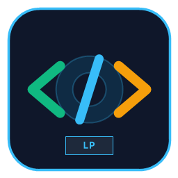

# Compiladores - Analizador Léxico, Sintáctico (Parser) e Intérprete para Lenguaje LP

<p align="center">
  
  <br>
  <strong>Compilador, Analizador Léxico, Parser por Descenso Recursivo, Árbol AST e Intérprete LP (C++20)</strong>
</p>

Compilador desarrollado en C++20 para el lenguaje formal **LP (Lenguaje de Programación)**, correspondiente al **Entregable 1 (30%) de la fase de Análisis Sintáctico y Motor de Ejecución en Tiempo Real**. Incluye:
* **Analizador sintáctico por descenso recursivo puro** y construcción del Árbol de Sintaxis Abstracta (AST).
* **Árbol legible en Windows y consola**: ramas ASCII alineadas y literales Unicode visibles en la interfaz.
* **Motor de Ejecución en Tiempo Real (Intérprete LP)**: Evalúa programas válidos directamente en memoria (variables, arreglos multidimensionales, operadores aritméticos/lógicos/relacionales, llamadas unc, condicionales if/else, bucles while, println y 
eturn).
* **Tabla de Símbolos Optimizada**: Búsquedas e inserciones en tiempo constante amortizado O(1) mediante tabla hash std::unordered_map.
* **Portabilidad Total Sin Errores de DLLs**: Enlace estático de runtime C++ (-static-libgcc -static-libstdc++) y bundling de libwinpthread-1.dll, eliminando cualquier error de librerías faltantes en Windows.
* **Interfaz Gráfica Nativa Moderna (WinAPI v6)**: 6 pestañas interactivas con estilos visuales modernos de Windows 10/11 (manifiesto Common-Controls v6), consola terminal de ejecución integrada (fondo oscuro RGB(20,24,30) con texto verde terminal RGB(50,255,140)) y barra de herramientas con ejecución inmediata [ ▶ Ejecutar LP ].
* **Versión CLI Multiplataforma**: Ejecuta en Linux, Docker y Windows generando reportes completos en output/ (incluyendo output/ejecucion.txt).
* **Suites de Pruebas Automatizadas**: 100% de cobertura en pruebas de léxico, sintáctico, modo pánico, detección de anomalías y runtime.

---

##  Documentación del Proyecto

Para consultar los detalles técnicos, guías y registros de evolución del proyecto, consulta los siguientes documentos:

* 📄 **[Changelog (Registro de Cambios)](CHANGELOG.md)**: Historial completo de versiones (v2.1.0 Intérprete LP y Rendimiento, v2.0.0 Entregable 1 Parser/AST, v1.0.0), nuevas características, correcciones y notas de lanzamiento.
* 🔧 **[Documentación Técnica de Funciones](DOCS_FUNCIONES.md)**: Detalle exhaustivo de todas las clases (`Parser`, `ASTNode`, `Lexer`, `ErrorHandler`, `SymbolTable`, `FileConverter`), métodos y algoritmos.
* 🏛️ **[Arquitectura del Sistema](ARQUITECTURA.md)**: Modelo arquitectónico en 4 capas, diagramas Mermaid, árbol sintáctico y estrategia de contención de errores en 4 niveles.
* 📖 **[Manual de Usuario](MANUAL_USUARIO.md)**: Guía paso a paso para operar la interfaz gráfica de 6 pestañas, la versión CLI, Docker y consultar los reportes en `output/`.


---

## 1. Especificación del Entregable 1 (Analizador Sintáctico)

### 1.1 Gramática Libre de Contexto de LP
El analizador sintáctico implementa directamente la gramática no ambigua mediante descenso recursivo:
* `PROGRAMA -> LISTA_FUNCIONES PRINCIPAL`
* `LISTA_FUNCIONES -> DECLARACION_FUNCION LISTA_FUNCIONES | ε`
* `DECLARACION_FUNCION -> [func] TIPO_RETORNO id ( PARAMETROS ) BLOQUE`
* `TIPO_RETORNO -> TIPO | void`
* `TIPO -> TIPO_BASE DIMENSION`
* `TIPO_BASE -> int | float | char | boolean | string`
* `DIMENSION -> [ num_int ] DIMENSION | ε`
* `PARAMETROS -> TIPO id LISTA_PARAMETROS | ε`
* `PRINCIPAL -> [TIPO_RETORNO] main ( ) BLOQUE`
* `BLOQUE -> { LISTA_VARIABLES COMANDOS }`
* `LISTA_VARIABLES -> TIPO id DIMENSION LISTA_ID ; LISTA_VARIABLES | ε`
* `COMANDOS -> COMANDO COMANDOS | ε`
* `COMANDO -> ASIGNACION | RETORNO | LECTURA | ESCRITURA | SELECCION | MIENTRAS | FUNCION`
* `ASIGNACION -> id [DIMENSION] = COMPLEMENTO ;`
* `COMPLEMENTO -> EXPRESION | FUNCION`
* `FUNCION -> func id ( ARGUMENTOS )`
* Jerarquía de expresiones: `EXPRESION -> EXPRESION_O -> EXPRESION_Y -> EXPRESION_NO -> EXPRESION_COMP -> EXPRESION_ADITIVA -> EXPRESION_MULT -> TERMINO_EXPR`.
* `RETORNO -> return EXPRESION ;`

### 1.2 Programas de Prueba del Entregable 1
* **Programa Mínimo Válido (Sección 4.2)**: [`tests/entregable1_valido.lp`](tests/entregable1_valido.lp) &rarr; **Aceptado (0 errores)**.
* **Programa Mínimo Inválido (Sección 4.3 - Falta `;`)**: [`tests/entregable1_invalido1.lp`](tests/entregable1_invalido1.lp) &rarr; **Rechazado (detecta falta de punto y coma)**.
* **Programa Inválido por Bloque Abierto**: [`tests/entregable1_invalido2.lp`](tests/entregable1_invalido2.lp) &rarr; **Rechazado**.
* **Programa con Funciones y `func`**: [`tests/entregable1_funciones.lp`](tests/entregable1_funciones.lp) &rarr; **Aceptado con AST completo**.

## 1. Especificación Léxica de LP

### 1.1 Números e Identificadores
* **NUM_INT**: Dígitos enteros `[0-9]+` &rarr; `<NUM_INT>`
* **NUM_DEC**: Dígitos decimales `[0-9]+\.[0-9]+` &rarr; `<NUM_DEC>`
* **ID**: Identificadores `[a-zA-Z_][a-zA-Z0-9_]*` &rarr; `<ID,pos>` *(donde pos es su índice único en la tabla de símbolos)*
* **TEXTO**: Cadenas de caracteres `"..."` &rarr; `<TEXTO>`

### 1.2 Palabras Reservadas
| Lexema | Token | Lexema | Token |
|---|---|---|---|
| `int` | `<INT>` | `void` | `<VOID>` |
| `float` | `<FLOAT>` | `main` | `<MAIN>` |
| `char` | `<CHAR>` | `if` | `<IF>` |
| `boolean` | `<BOOLEAN>` | `else` | `<ELSE>` |
| `for` | `<FOR>` | `while` | `<WHILE>` |
| `scanf` | `<SCANF>` | `println` | `<PRINTLN>` |
| `return` | `<RETURN>` | `string` | `<STRING>` |

### 1.3 Operadores
* **Asignación:** `=` &rarr; `<=>`
* **Aritméticos:** `+` &rarr; `<+>`, `-` &rarr; `<->`, `*` &rarr; `<*>`, `/` &rarr; `</>`, `%` &rarr; `<%>`
* **Lógicos:** `&&` &rarr; `<&&>`, `||` &rarr; `<||>`, `!` &rarr; `<!>`
* **Comparación:** `>`, `>=`, `<`, `<=`, `!=`, `==` &rarr; `<COMP>`

### 1.4 Delimitadores y Símbolos Especiales
* `(` &rarr; `<(>`, `)` &rarr; `<)>`
* `[` &rarr; `<[>`, `]` &rarr; `<]>`
* `{` &rarr; `<{>`, `}` &rarr; `<}>`
* `,` &rarr; `<,>`, `;` &rarr; `<;>`

### 1.5 Comentarios
* De una línea: `//.*\n` &rarr; Reconocidos y descartados.
* De bloque: `/* ... */` &rarr; Reconocidos y descartados.

---

## 2. Ejemplo Oficial de Ejecución

### Código Fuente de Entrada:
```c
void main() {
int edad = 20;
float promedio = 15.5;
if (edad >= 18 && edad <= 60) {
println("Edad valida");
}
return;
}
```

### Secuencia de Tokens Resultante:
```text
<VOID> <MAIN> <(> <)> <{>
<INT> <ID,0> <=> <NUM_INT> <;>
<FLOAT> <ID,1> <=> <NUM_DEC> <;>
<IF> <(> <ID,0> <COMP> <NUM_INT> <&&> <ID,0> <COMP> <NUM_INT> <)> <{>
<PRINTLN> <(> <TEXTO> <)> <;>
<}>
<RETURN> <;>
<}>
```

### Tabla de Símbolos:
| Posición | Identificador | Línea Inicial | Apariciones |
|---|---|---|---|
| 0 | `edad` | Línea 2 | L2, L4, L4 |
| 1 | `promedio` | Línea 3 | L3 |

---

## 3. Compilación y Ejecución

### Paquete portable para Windows x64

El archivo `dist/Compiladores-portable-windows-x64.zip` se genera con
`./package_portable.ps1` después de compilar `Compiladores` y `compilador_lp`
en `cmake-build-release-portable`. Extrae el ZIP completo en una carpeta con
permisos de escritura. Usa `abrir_gui.bat` para la interfaz o
`ejecutar_cli.bat` para la consola. Los reportes se escriben en `output/`.
La lectura de PDF requiere Microsoft Word instalado.


### 3.1 Aplicación Visual (GUI Windows con 6 Pestañas, AST y Consola de Ejecución)
```powershell
cmake --build cmake-build-debug --target Compiladores
.\cmake-build-debug\Compiladores.exe
```

### 3.2 Aplicación por Consola (CLI Multiplataforma con AST y Diagnóstico)
```powershell
cmake --build cmake-build-debug --target compilador_lp
.\cmake-build-debug\compilador_lp.exe input/ejemplo.lp
```

### 3.3 Ejecutar Pruebas Automatizadas
```powershell
# Pruebas del Analizador Léxico (7 tests)
cmake --build cmake-build-debug --target test_lexer
.\cmake-build-debug\test_lexer.exe

# Pruebas del Analizador Sintáctico y AST - Entregable 1 (7 tests)
cmake --build cmake-build-debug --target test_parser
.\cmake-build-debug\test_parser.exe
```

---

## 4.  Entorno Docker (Dockeado)

El proyecto incluye soporte completo para ejecución contenedorizada en Linux mediante Docker y Docker Compose:

### Construir y Ejecutar con Docker:
```bash
# Construir la imagen optimizada
docker build -t compiladores-lp .

# Ejecutar el analizador sobre el archivo por defecto
docker run --rm -v $(pwd)/output:/app/output compiladores-lp

# Ejecutar sobre un archivo específico
docker run --rm -v $(pwd)/input:/app/input -v $(pwd)/output:/app/output compiladores-lp input/mi_codigo.lp

# Ejecutar la suite de pruebas unitarias
docker run --rm --entrypoint /app/test_lexer compiladores-lp
```

### Uso con Docker Compose:
```bash
# Levantar y procesar input/ejemplo.lp
docker compose up compilador

# Ejecutar pruebas unitarias
docker compose run --rm test
```

---

## 5. Publicar Release en GitHub:
```powershell
.\release.ps1 1.0.0
```
